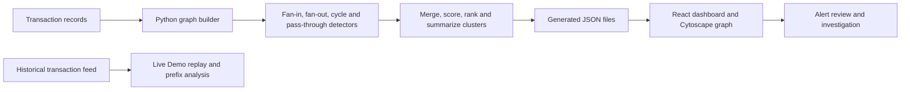
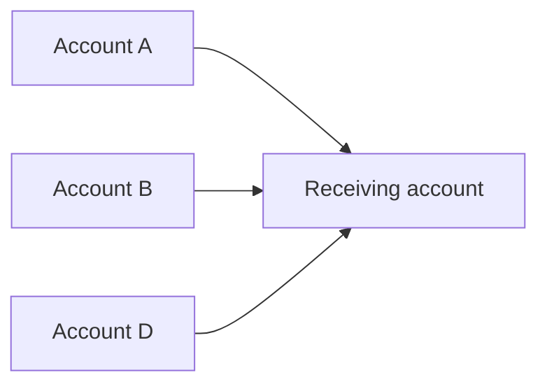
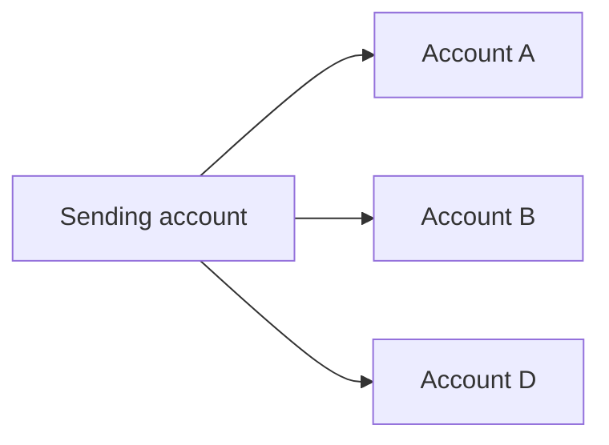
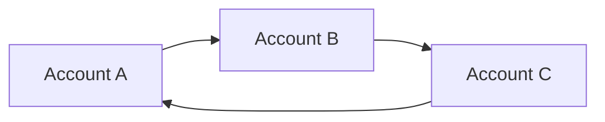
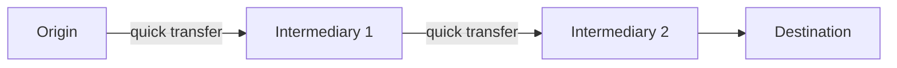
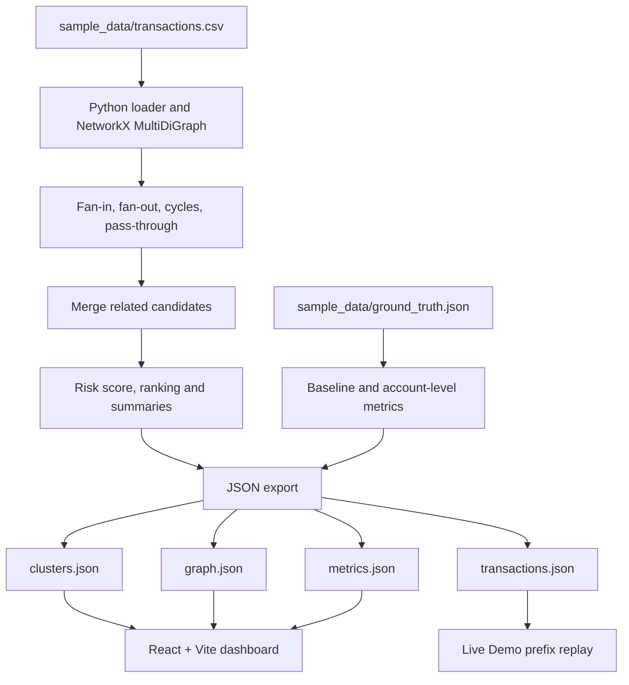

# TRACE — Financial Crime Intelligence

### Follow the money. Uncover the network.

[**Open the live project**](https://shell-shock-rouge.vercel.app/) · [GitHub repository](https://github.com/dakshagarwal008/Shell-shock)

TRACE turns transaction records into a temporal, directed network so suspicious activity can be examined across connected accounts. Transaction-by-transaction AML rules can miss patterns that only emerge when money moves through a group of accounts. TRACE detects fan-in, fan-out, cyclic round-tripping, and rapid pass-through patterns, ranks the resulting clusters, and presents their transactions and detection rationale for review. Explore the dashboard and replay demonstrations in the [live project](https://shell-shock-rouge.vercel.app/).

## The problem

A suspicious network may receive money from multiple accounts, move it through intermediary accounts, then distribute it to other accounts. Each transfer might look ordinary in isolation; the relationships between accounts and the sequence of transfers can reveal a pattern worth investigating.

The direction of a transfer, its amount, when it happened, and how it connects to other transfers all matter. TRACE represents these relationships directly. Its risk score is a review-prioritization signal, not a finding of criminal activity.

## How TRACE works

TRACE builds a temporal directed graph from transaction records. Each account is a node; each transfer is a directed edge with an amount and timestamp. Detectors find candidate patterns, merge detections that share accounts or transactions into clusters, score and rank clusters, and attach a plain-language, cluster-level explanation. The frontend renders the generated data as alerts, a network graph, and investigation views.



## Laundering typologies

These shapes are indicators for review, not proof of laundering. Legitimate activity can produce similar structures.

### 1. Fan-in

Multiple accounts send funds to a common account. This aggregation can be suspicious when combined with other evidence, but fundraising, collections, and many ordinary payments also create fan-in.



### 2. Fan-out

A common account sends funds to multiple recipients. This can represent dispersal, but payroll, supplier payments, and other legitimate business activity can have the same shape.



### 3. Cyclic round-tripping

Funds move through a sequence of accounts and return to an earlier account. A circular path may be used to obscure a source or create misleading transaction history. TRACE looks for timestamp and amount continuity when identifying cycles.



### 4. Rapid pass-through / mule chains

Funds pass through intermediary accounts quickly, with amounts that remain within configured tolerances. A short, near-value chain can warrant review because it may obscure the trail, though fast transfers also have legitimate explanations.



## Key features

- **Interactive transaction graph:** Cytoscape renders account nodes and directed transfers. Zoom, pan, and selection help trace connected activity and inspect selected clusters.
- **Risk-ranked cluster alerts:** The dashboard orders detector clusters by backend risk score. Severity bands are display labels derived from that score.
- **Typology and evidence:** Alerts show detected typologies, account and transaction counts, amounts, time span, and the backend-generated explanation and risk factors.
- **Search, filters, and sorting:** Search account or cluster identifiers, filter by typology or risk level, and sort by risk, amount, or account count.
- **Investigation Mode:** Open an alert to review its graph, accounts, timestamped transactions, and explanation; replay and focus the money trail.
- **Money Trail Replay:** Step through a cluster's timestamped transfers in order. The current transaction and endpoints are highlighted in the graph; timeline and playback controls are provided.
- **Live Demo:** Replay the historical transaction feed, watch the graph and developing alerts update, and inspect analysis of transaction prefixes.
- **Exception Demo:** Compare four synthetic fan-in/fan-out scenarios in one graph and replay, with the scenario evaluator distinguishing a structural pattern from evidence-supported alerts.
- **Evaluation panel:** Review checked-in precision, recall, and F1 results for graph detection and a threshold baseline, plus dataset counts.
- **Investigation report export:** Use **Export Investigation Report** to open the browser print dialog and print or save the investigation as PDF where supported.

## Investigation and explainability

Select an alert and choose **Open Investigation Mode**. TRACE provides the risk score and derived severity, detected typology, connected accounts, transaction total, time span and date range, and supporting transaction identifiers, routes, amounts, and timestamps. The investigation graph shows the cluster's supplied transfers; **Replay Money Trail** advances through timestamped transfers and highlights the active edge and accounts. Evidence references can focus matching accounts and connected transfers. The backend explanation is a cluster-level summary, and the interface identifies it as such rather than presenting it as transaction-level proof.

The investigation view is designed to make an alert reviewable: it exposes the evidence and path behind a score, with a print/PDF export through the browser.

## Live Demo mode

Choose **Live Demo** from **Select Demo**. This is a historical/demo-data replay simulation, not a real-time connection to a bank or live transaction network. It reads the chronological `transactions.json` feed, advances through records, updates the graph and transaction feed, and runs detection on arrived prefixes in a Web Worker at checkpoints (every 50 records and at the end). It is not continuous per-transaction detection.

The interface provides replay start/pause/resume/restart controls, a speed control, transaction progress, a transaction feed, and a developing alert list. As records arrive, observe transfers appear and prefix-based patterns and alerts change. Selecting an alert opens its investigation; the replay pauses while reviewing it. Restart returns the simulation to the beginning.

## Exception Demo — context matters

A fan-in or fan-out structure alone does not establish financial crime. A fundraiser may collect many incoming payments; a company may make many outgoing payments. TRACE's Exception Demo puts four **synthetic demo-data** examples in four distinct regions of the same graph:

| Scenario | Pattern | What to observe |
| --- | --- | --- |
| Legitimate charity / fundraiser | Fan-in | Incoming payments alone should not establish an AML alert. |
| Suspicious receiving network | Fan-in | Further suspicious movement can supply evidence for an alert. |
| Legitimate company payouts | Fan-out | Outgoing payments alone should not establish an AML alert. |
| Suspicious distribution network | Fan-out | Further suspicious movement can supply evidence for an alert. |

All four regions share one chronological replay controller. As transactions arrive, compare the regions and watch the scenario results and supporting investigation evidence. The examples illustrate contextual analysis; TRACE does not certify a charity or company and does not automatically exempt either from review.

**All scenarios in this demonstration use synthetic demo data.**

The main Python pipeline detects patterns in the transaction graph, merges candidates, and scores clusters. The Exception Demo uses a separate frontend scenario assessment (`exceptionAssessment.js`) on each scenario's arrived transaction prefix. That demonstration/evaluation layer is separate from the checked-in backend cluster outputs; its scenario results should not be read as a claim that the backend automatically classifies real charities or companies.

## Evaluation and performance

The checked-in `metrics.json` reports account-level metrics for the supplied generated evaluation dataset: 2,875 transactions, 462 accounts, and 9 planted clusters. The baseline is a threshold-based detector; the graph method uses the graph pattern pipeline. Current values are:

| Method | Precision | Recall | F1 | TP | FP | FN |
| --- | ---: | ---: | ---: | ---: | ---: | ---: |
| Threshold baseline | 0.1818 | 0.0896 | 0.1200 | 6 | 27 | 61 |
| Graph method | 1.0000 | 1.0000 | 1.0000 | 67 | 0 | 0 |

Precision is the share of predicted accounts that belong to planted ground truth; recall is the share of ground-truth accounts detected; F1 is their harmonic mean. These help describe missed and extra detections alongside correct matches.

These results are from the repository's synthetic, planted evaluation data and account-level metric implementation. They are not an independent or real-world validation, and should not be generalized as production performance or proof of superiority on external data. The perfect graph-method score reflects this project evaluation setup and requires validation on larger, independent, representative datasets.

## Technology stack

- **Frontend:** React 18, JavaScript, Vite 6
- **Graph visualization:** Cytoscape.js
- **Detection and data pipeline:** Python, NetworkX, pandas, NumPy
- **Data exchange:** Static JSON files served from the Vite public directory
- **Deployment:** Static frontend configured for Vercel; the Python pipeline generates the JSON assets before deployment

## System architecture



`run_pipeline.py` generates the seeded sample dataset, builds a NetworkX directed multigraph, runs the four detectors, merges and scores clusters, attaches summaries, computes baseline and graph metrics, and writes JSON to `web/public/data/`. The frontend fetches `clusters.json`, `graph.json`, and `metrics.json`; Live Demo separately fetches the full chronological `transactions.json` feed. Vite copies public assets into its static build. The Python pipeline is not a runtime web service; the deployed frontend needs the generated JSON files alongside the built assets.

The generated data contracts are:

- `clusters.json`: IDs, ranks, scores, typologies, accounts, totals, time spans, summaries, risk factors, and transaction IDs.
- `graph.json`: flagged cluster nodes and directed transaction edges with amounts, timestamps, and cluster IDs.
- `metrics.json`: baseline and graph-method account-level metrics and dataset counts.
- `transactions.json`: all historical transaction records with IDs, source, target, amount, and timestamp, used by Live Demo.

## Installation and local setup

### Prerequisites

- Python 3.10 or newer (the source uses modern Python type syntax)
- Node.js and npm

### 1. Clone and generate dashboard data

From the repository root:

```bash
git clone https://github.com/dakshagarwal008/Shell-shock.git
cd Shell-shock
python -m venv .venv
```

Activate the environment, install Python dependencies, and run the pipeline:

```powershell
# Windows PowerShell
.venv\Scripts\Activate.ps1
pip install -r requirements.txt
python run_pipeline.py
```

```bash
# macOS / Linux
source .venv/bin/activate
pip install -r requirements.txt
python run_pipeline.py
```

The pipeline uses seed `42`, regenerates `sample_data/transactions.csv` and `sample_data/ground_truth.json`, then exports `clusters.json`, `graph.json`, `metrics.json`, and `transactions.json` to `web/public/data/`.

### 2. Run the frontend

In a second terminal from the repository root:

```bash
cd web
npm install
npm run dev
```

Open the local URL printed by Vite. To create a production build, run from `web/`:

```bash
npm run build
```

The repository also defines `npm run preview` to serve the built frontend locally. Python dependencies are listed in `requirements.txt`; frontend scripts are in `web/package.json`.

## Judge's Quick Guide — Explore TRACE

**Recommended exploration order:**

Dashboard → Transaction Graph → Investigate an Alert → Live Demo → Exception Demo → Evaluation

1. **Open the project:** Visit [TRACE](https://shell-shock-rouge.vercel.app/). Use the landing page's dashboard entry to open the investigation workspace.
2. **Explore the dashboard:** Review the metrics banner and ranked suspicious alerts. Search by account or cluster ID, filter by typology or risk level, and sort by **Risk**, **Amount**, or **Accounts**. Severity is a band derived from the risk score.
3. **Explore the transaction graph:** Nodes are accounts; arrows are directed transfers, with amount and timestamp details on selection. Zoom and pan to inspect the network, select graph items, and choose a suspicious cluster to highlight its network.
4. **Investigate an alert:** Choose **Open Investigation Mode**. Review score, typology, accounts, transaction period and supporting transfers; use **Replay Money Trail** to follow the highlighted route, read the backend explanation, and choose **Export Investigation Report** for print/PDF.
5. **Try Live Demo:** Choose **Live Demo** in **Select Demo**, start replay, pause/resume, change speed, and watch the progress, feed, graph, and developing alerts. Restart to repeat. It uses historical demo data, not live banking connections.
6. **Try Exception Demo:** Choose **Exception Demo**, observe its four graph regions, then start the shared replay. Compare the legitimate and suspicious fan-in examples and the legitimate and suspicious fan-out examples. Watch outcomes emerge, read the comparison panel, and open supporting investigation evidence where available. **A transaction pattern is a signal, not proof of financial crime.** All scenarios are synthetic.
7. **Review evaluation:** Return to the dashboard's metrics banner to compare precision, recall, and F1 for the threshold baseline and graph method. Values are account-level results on the supplied synthetic planted dataset; see [Evaluation and performance](#evaluation-and-performance) for interpretation and limits.


## Final takeaway

Financial crime is rarely visible in a single transaction. TRACE connects the dots across accounts, follows the movement of money, and turns suspicious transaction networks into explainable investigations.

[**Explore the live project**](https://shell-shock-rouge.vercel.app/) · [View the GitHub repository](https://github.com/dakshagarwal008/Shell-shock)
