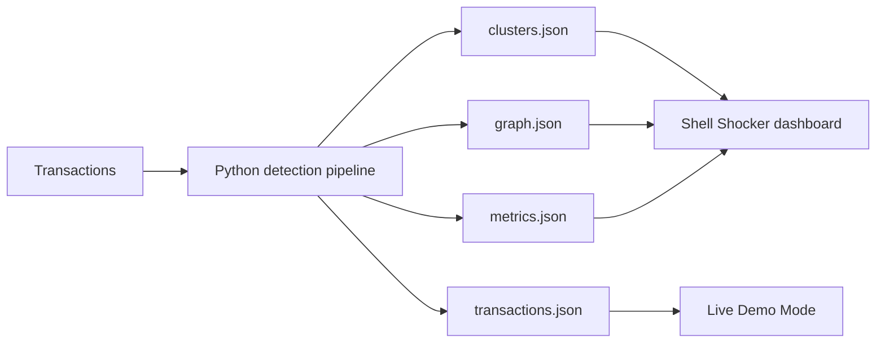

# Shell Shocker | Financial Crime Intelligence

Shell Shocker analyzes transaction networks to surface suspicious account clusters and explain the activity behind each finding. The dashboard presents ranked alerts, typologies, transaction trails, graph relationships, backend risk factors, and model evaluation metrics.

## What it does

- Builds a directed, weighted transaction graph from transaction records.
- Detects fan-in aggregation, fan-out dispersion, cyclic round-tripping, and rapid pass-through patterns.
- Groups related detections into account clusters and ranks them with the backend risk score.
- Displays backend-generated explanations and risk factors for each cluster alert.
- Supports account search, risk and typology filters, sorting, and graph zoom, pan, and selection.
- Opens a dedicated Investigation Mode for each selected cluster alert, with chronological money trail replay, timeline controls, and evidence-linked graph highlighting.
- Adds an isolated Live Demo Mode that replays the historical transaction feed, incrementally updates the transaction graph, and evaluates detection on arrived transaction prefixes.
- Exports the investigation view through the browser's print dialog, including Save as PDF where supported.
- Compares graph detection with the threshold baseline using precision, recall, F1, and TP/FP/FN counts.

Severity labels in the dashboard are display bands derived from each backend risk score. The score and backend scoring logic are unchanged. The current data does not provide investigation workflow statuses, so the dashboard does not show a status field.

## Review 2 demonstration

The review walkthrough can show the application using its integrated detection output:

1. Compare baseline and graph-method precision, recall, and F1 metrics.
2. Search and filter risk-ranked cluster alerts by account, typology, or risk level.
3. Select an alert to inspect its highlighted account network, directed transfers, risk score, and backend summary.
4. Open Investigation Mode to review the alert, replay timestamped transfers chronologically, and focus graph accounts referenced by the backend evidence summary.
5. Export the investigation view with the browser print dialog or save it as a PDF where supported.
6. Open Live Demo Mode to replay the historical dataset and see prefix-based developing alerts.

The review uses the checked-in `clusters.json`, `graph.json`, and `metrics.json` outputs; the displayed transaction paths and amounts come from those records.

## Project structure

```text
.
|-- run_pipeline.py          # Runs detection and exports dashboard JSON
|-- sample_data/             # Generated transactions and evaluation ground truth
|-- src/                     # Graph building, detectors, scoring, and export code
|-- tests/                   # Backend detector tests
`-- web/                     # Vite + React dashboard
    `-- public/data/          # clusters.json, graph.json, metrics.json
```

## Data flow



The frontend fetches `/data/clusters.json`, `/data/graph.json`, and `/data/metrics.json` from `web/public/data/`. Live Demo Mode separately loads `/data/transactions.json`, an additive chronological export of the same dataset. Running the pipeline regenerates the dataset with seed `42` and writes all four files.

### Data contracts

- `clusters.json`: cluster ID, rank, backend risk score, detected typologies, accounts, transaction IDs, total amount, time span, generated evidence summary, and weighted risk factors.
- `graph.json`: account nodes with cluster memberships and risk values; directed transaction edges with IDs, endpoints, amounts, timestamps, and cluster IDs.
- `metrics.json`: `baseline`, `graph_method`, and `dataset` evaluation data.
- `transactions.json`: chronological historical transaction records with `id`, `source`, `target`, `amount`, and `timestamp`; used only by Live Demo Mode.

The UI derives transaction periods from graph edge timestamps. It does not invent timestamps, status values, evidence, accounts, or transactions when the backend omits them.

Live Demo Mode is explicitly a historical simulation. It evaluates the existing detection and risk-scoring rules in a Web Worker against transactions replayed so far, at 50-record checkpoints (and at the final record). Each checkpoint recomputes the current prefix; detection is not a continuously updated per-transaction algorithm. The original completed-analysis JSON files and normal dashboard state are separate from the replay state.

Investigation replay uses the selected cluster's transaction IDs and matching graph edges, ordered by their supplied timestamps. Records without usable timestamps remain visible in the report but are excluded from timed playback. Detection explanations are cluster-level summaries from the backend; account references in each summary item can focus the matching account nodes and connected cluster transfers.

## Run locally

### 1. Generate the dashboard data

From the repository root, create and activate a Python environment, then install the backend requirements and run the pipeline.

```powershell
python -m venv .venv
.venv\Scripts\Activate.ps1
pip install -r requirements.txt
python run_pipeline.py
```

The pipeline writes generated transaction and ground-truth files under `sample_data/` and exports the dashboard JSON files and the additive historical replay feed under `web/public/data/`.

### 2. Start the frontend

In a second terminal:

```powershell
cd web
npm install
npm run dev
```

Vite prints the local development URL when it starts. The dashboard can also be built with `npm run build` from the `web/` directory.

### Run backend tests

From the repository root, run:

```powershell
pytest
```

## Deployment

The dashboard is a static Vite application. Deploy the `web/` directory with Vercel using the Vite framework preset. The Python pipeline is not required at runtime; deploy the generated JSON files in `web/public/data/` with the frontend.
