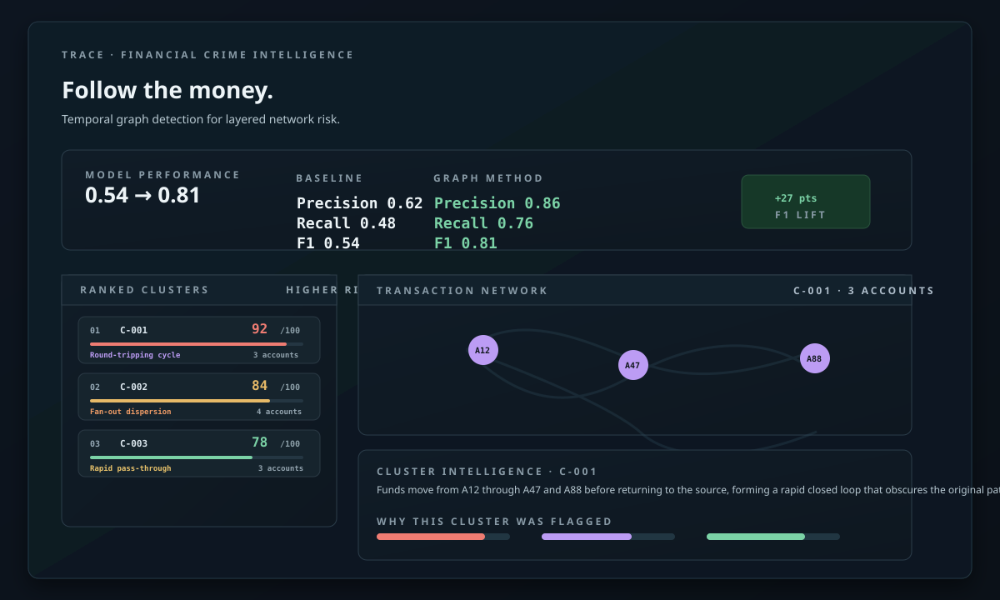
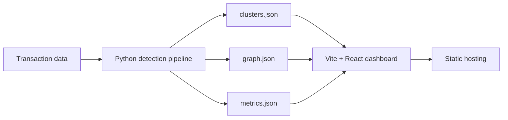

# TRACE — Financial Crime Intelligence

TRACE detects layered money laundering patterns by modeling transactions as a temporal, directed, weighted graph. It surfaces fan-in and fan-out dispersion, cyclic round-tripping, and rapid pass-through networks; ranks suspicious clusters by risk; and explains the money trail and signals behind each flag. The dashboard compares graph detection with a threshold baseline using precision, recall, F1, and TP/FP/FN counts.



## Architecture



The app is a static Vite site. The pipeline writes its output to `web/public/data/`; the browser loads those JSON files directly. Vercel can serve the built dashboard without running Python.

## Run locally

```sh
pip install -r requirements.txt
python run_pipeline.py
cd web && npm install && npm run dev
```

The checked-in JSON under `web/public/data/` is sample data for the dashboard. Replace it with the pipeline's output to view a real run. Production build: `cd web && npm run build`.

## Deployment and demo

Deployment target: Vercel, project root `web`, Vite framework preset. Live dashboard: _add Vercel URL_. Demo video: _add recording link_.
